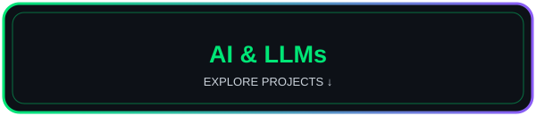
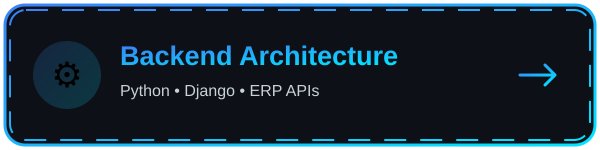
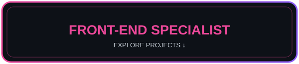
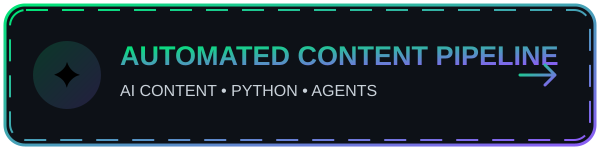
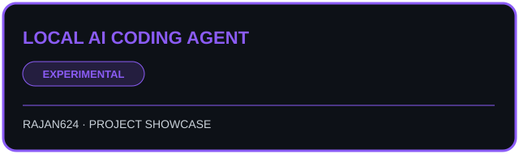
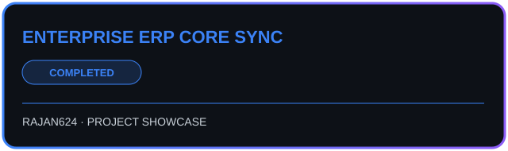
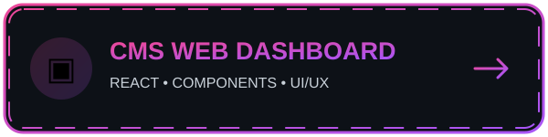
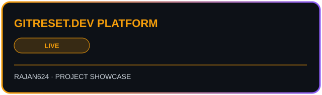

<h1>Hi there, I'm Rajan Kumar 👋</h1>

<h3>Senior AI Engineer | Backend Architect | Full-Stack Developer</h3>

<i>Building scalable architectures | Integrating Generative AI (Gemini/Ollama) | Creator of gitreset.dev</i>

  <a href="mailto:rkp33510@gmail.com">✉️ Email</a> ·
  <a href="https://linkedin.com/in/rajan-kumar-4158211a0">🔗 LinkedIn</a> ·
  <a href="https://drive.google.com/file/d/1oy1QaKGAoC3T-FlTfIb9-JJ-m4YrZB1x/view?usp=sharing">📄 Resume</a> ·
  <a href="https://gitreset.dev">🌐 Website</a>

---

<!-- 2. QUICK JUMP DASHBOARD (same four-card structure) -->

  <h2>⚡ QUICK JUMP DASHBOARD ⚡</h2>
  
  
<i>Select your area of interest to instantly navigate to that vertical.</i>

<table align="center" width="100%">
  <tr>
    <td align="center" width="30%">
      <a href="#1-ai--llm-development">
        
        <h2>🤖 AI &amp; LLMs</h2>
        
<i>Generative AI, Agents &amp; Prompts</i>

        <b>👉 CLICK TO JUMP</b>
      </a>
    </td>
    <td width="5%"></td>
    <td align="center" width="30%">
      <a href="#2-backend--api-architecture">
        
        <h2>⚙️ Backend</h2>
        
<i>Python, Django &amp; ERP APIs</i>

        <b>👉 CLICK TO JUMP</b>
      </a>
    </td>
    <td width="5%"></td>
    <td align="center" width="30%">
      <a href="#3-frontend-specialist">
        
        <h2>💻 Front-End</h2>
        
<i>React, UI/UX &amp; Redux</i>

        <b>👉 CLICK TO JUMP</b>
      </a>
    </td>
  </tr>
  <tr>
    <td></td><td></td>
    <td align="center" width="30%">
      <a href="#4-full-stack--devops">
        
        <h2>🌐 Full-Stack</h2>
        
<i>MERN, Cloud &amp; Deployments</i>

        <b>👉 CLICK TO JUMP</b>
      </a>
    </td>
    <td></td><td></td>
  </tr>
</table>

---

<!-- 3. FOUR PROJECT CATEGORIES -->

  <h1>🤖 1. AI DEVELOPER &amp; LLMs</h1>
  
  <h3>Focus: Retrieval Augmented Generation (RAG), Local LLMs &amp; Prompt Engineering</h3>

 

<b>🐍 Python</b> · <b>✨ Gemini</b> · <b>🦙 Ollama</b>

  
<b>🔥 Hide / Collapse AI Projects</b>

   
  <table width="100%">
    <tr>
      <td width="50%" valign="top">
        <h3>🔹 Automated Content Pipeline</h3>
        
<b>🟢 Status:</b> In Progress

        
<b>📝 Description:</b> Multi-platform content generation system that automatically creates, formats, and schedules videos using AI.

        
<b>✨ Highlights:</b> Python, Gemini API, AI Agents.

      </td>
      <td width="50%" valign="center">
        <!-- Replace YOUR_AI_REPO with the actual repository name -->
        
      </td>
    </tr>
  </table>
   
  <table width="100%">
    <tr>
      <td width="50%" valign="top">
        <h3>🔹 Local AI Coding Agent</h3>
        
<b>🟣 Status:</b> Experimental

        
<b>📝 Description:</b> Secure offline AI developer environment configured with custom system prompts to review and write codebase.

        
<b>✨ Highlights:</b> Ollama setup, VS Code integration, 100% data privacy.

      </td>
      <td width="50%" valign="center">
        
      </td>
    </tr>
  </table>

<a href="#top">⬆ Back to top</a>

  

  <h1>⚙️ 2. BACKEND ARCHITECTURE</h1>
  
  <h3>Focus: High Performance APIs, Business Logic &amp; ERP Integrations (SAP/Zoho)</h3>

 

<b>🐍 Django</b> · <b>🛢️ MySQL</b> · <b>🍃 MongoDB</b>

  
<b>🔥 Hide / Collapse Backend Projects</b>

   
  <table width="100%">
    <tr>
      <td width="50%" valign="top">
        <h3>🔹 Enterprise ERP Core Sync</h3>
        
<b>🔵 Status:</b> Completed

        
<b>📝 Description:</b> A robust data-syncing API layer handling seamless, secure data flow between manufacturing systems.

        
<b>✨ Highlights:</b> SAP/QuickBooks integration, Celery background tasks.

      </td>
      <td width="50%" valign="center">
        
      </td>
    </tr>
  </table>

<a href="#top">⬆ Back to top</a>

  

  <h1>💻 3. FRONT-END SPECIALIST</h1>
  
  <h3>Focus: Accessible Interfaces, React Component Architecture &amp; Redux</h3>

 

<b>⚛️ React</b> · <b>🔄 Redux</b> · <b>🟨 JavaScript</b>

  
<b>🔥 Hide / Collapse Front-End Projects</b>

   
  <table width="100%">
    <tr>
      <td width="50%" valign="top">
        <h3>🔹 CMS Web Dashboard</h3>
        
<b>💗 Status:</b> Live

        
<b>📝 Description:</b> Frontend interface for managing digital content, providing users with a fast and intuitive state-optimized experience.

        
<b>✨ Highlights:</b> Component architecture. <a href="https://cms-web-app-07.web.app/">Live Link</a>.

      </td>
      <td width="50%" valign="center">
        
      </td>
    </tr>
  </table>

<a href="#top">⬆ Back to top</a>

  

  <h1>🌐 4. FULL-STACK &amp; DEVOPS</h1>
  
  <h3>Focus: Full Lifecycle, Cloud Deployments (Vercel/AWS) &amp; CI/CD Pipelines</h3>

 

<b>🟢 Node.js</b> · <b>🐳 Docker</b> · <b>▲ Vercel</b>

  
<b>🔥 Hide / Collapse Full-Stack Projects</b>

   
  <table width="100%">
    <tr>
      <td width="50%" valign="top">
        <h3>🔹 gitreset.dev Platform</h3>
        
<b>🟠 Status:</b> Live

        
<b>📝 Description:</b> A central hub for developer resources, tutorials, and automated tools, fully designed and deployed by me.

        
<b>✨ Highlights:</b> MERN stack, Cloud Auth, CI/CD pipelines.

      </td>
      <td width="50%" valign="center">
        
      </td>
    </tr>
  </table>

<a href="#top">⬆ Back to top</a>

---

## 📊 GITHUB PROFILE SNAPSHOT

  

 

  <h3>👀 Thanks for visiting!</h3>
  
<b>Build. Learn. Improve. Repeat.</b>

  

