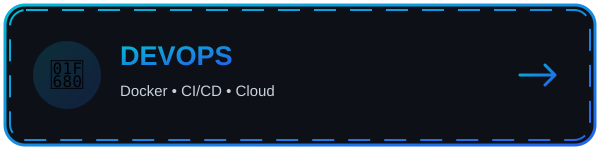
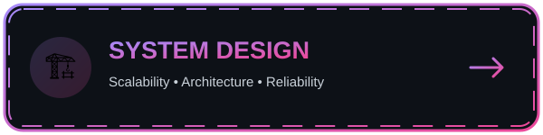
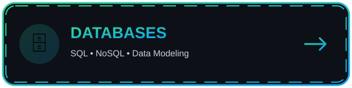
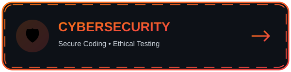
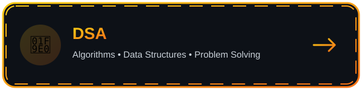

<h1>Hi there, I'm Rajan Kumar 👋</h1>

<h3>Senior AI Engineer | Backend Architect | Full-Stack Developer</h3>

<b>⚡ Engineering scalable systems • Building useful AI • Shipping reliable products</b>

<i>Building scalable architectures | Integrating Generative AI (Gemini/Ollama) | Creator of gitreset.dev</i>

  <a href="mailto:rkp33510@gmail.com">✉️ Email</a> ·
  <a href="https://linkedin.com/in/rajan-kumar-4158211a0">🔗 LinkedIn</a> ·
  <a href="https://drive.google.com/file/d/1oy1QaKGAoC3T-FlTfIb9-JJ-m4YrZB1x/view?usp=sharing">📄 Resume</a> ·
  <a href="https://gitreset.dev">🌐 Website</a>

---

<!-- 2. QUICK JUMP DASHBOARD (nine topic cards in a 3 x 3 layout) -->

  <h2>⚡ QUICK JUMP DASHBOARD ⚡</h2>
  
  
<i>Select your area of interest to instantly navigate to that vertical.</i>

<table align="center" width="100%">
  <tr>
    <td align="center" width="33%">
      <a href="#1-ai--llm-development">
        
        <h3>🤖 AI &amp; LLMs</h3>
        
<i>Generative AI, RAG &amp; Agents</i>

        <b>👉 CLICK TO JUMP</b>
      </a>
    </td>
    <td align="center" width="33%">
      <a href="#2-backend--api-architecture">
        
        <h3>⚙️ Backend</h3>
        
<i>Python, Django &amp; APIs</i>

        <b>👉 CLICK TO JUMP</b>
      </a>
    </td>
    <td align="center" width="33%">
      <a href="#3-frontend-specialist">
        
        <h3>💻 Frontend</h3>
        
<i>React, UI/UX &amp; Redux</i>

        <b>👉 CLICK TO JUMP</b>
      </a>
    </td>
  </tr>
  <tr>
    <td align="center" width="33%">
      <a href="#4-full-stack-development">
        
        <h3>🌐 Full-Stack</h3>
        
<i>MERN, Apps &amp; Integration</i>

        <b>👉 CLICK TO JUMP</b>
      </a>
    </td>
    <td align="center" width="33%">
      <a href="#5-devops-engineering">
        
        <h3>🚀 DevOps</h3>
        
<i>Docker, CI/CD &amp; Cloud</i>

        <b>👉 CLICK TO JUMP</b>
      </a>
    </td>
    <td align="center" width="33%">
      <a href="#6-system-design">
        
        <h3>🏗️ System Design</h3>
        
<i>Scalability &amp; Architecture</i>

        <b>👉 CLICK TO JUMP</b>
      </a>
    </td>
  </tr>
  <tr>
    <td align="center" width="33%">
      <a href="#7-databases">
        
        <h3>🗄️ Databases</h3>
        
<i>SQL, NoSQL &amp; Data Modeling</i>

        <b>👉 CLICK TO JUMP</b>
      </a>
    </td>
    <td align="center" width="33%">
      <a href="#8-cybersecurity-ethical-hacking">
        
        <h3>🛡️ Cybersecurity</h3>
        
<i>Security &amp; Ethical Hacking</i>

        <b>👉 CLICK TO JUMP</b>
      </a>
    </td>
    <td align="center" width="33%">
      <a href="#9-data-structures--algorithms">
        
        <h3>🧠 DSA</h3>
        
<i>Problem Solving &amp; Algorithms</i>

        <b>👉 CLICK TO JUMP</b>
      </a>
    </td>
  </tr>
</table>

---

<!-- 3. FOUR PROJECT CATEGORIES -->

  <h1>🤖 1. AI DEVELOPER &amp; LLMs</h1>
  
  <h3>Focus: Retrieval Augmented Generation (RAG), Local LLMs &amp; Prompt Engineering</h3>

 

<b>🐍 Python</b> · <b>✨ Gemini</b> · <b>🦙 Ollama</b>

  
<b>🔥 Hide / Collapse AI Projects</b>

   
  <table width="100%">
    <tr>
      <td width="50%" valign="top">
        <h3>🔹 Automated Content Pipeline</h3>
        
<b>🟢 Status:</b> In Progress

        
<b>📝 Description:</b> Multi-platform content generation system that automatically creates, formats, and schedules videos using AI.

        
<b>✨ Highlights:</b> Python, Gemini API, AI Agents.

      </td>
      <td width="50%" valign="center">
        <!-- Replace YOUR_AI_REPO with the actual repository name -->
        
      </td>
    </tr>
  </table>
   
  <table width="100%">
    <tr>
      <td width="50%" valign="top">
        <h3>🔹 Local AI Coding Agent</h3>
        
<b>🟣 Status:</b> Experimental

        
<b>📝 Description:</b> Secure offline AI developer environment configured with custom system prompts to review and write codebase.

        
<b>✨ Highlights:</b> Ollama setup, VS Code integration, 100% data privacy.

      </td>
      <td width="50%" valign="center">
        
      </td>
    </tr>
  </table>

<a href="#top">⬆ Back to top</a>

  

  <h1>⚙️ 2. BACKEND ARCHITECTURE</h1>
  
  <h3>Focus: High Performance APIs, Business Logic &amp; ERP Integrations (SAP/Zoho)</h3>

 

<b>🐍 Django</b> · <b>🛢️ MySQL</b> · <b>🍃 MongoDB</b>

  
<b>🔥 Hide / Collapse Backend Projects</b>

   
  <table width="100%">
    <tr>
      <td width="50%" valign="top">
        <h3>🔹 Enterprise ERP Core Sync</h3>
        
<b>🔵 Status:</b> Completed

        
<b>📝 Description:</b> A robust data-syncing API layer handling seamless, secure data flow between manufacturing systems.

        
<b>✨ Highlights:</b> SAP/QuickBooks integration, Celery background tasks.

      </td>
      <td width="50%" valign="center">
        
      </td>
    </tr>
  </table>

<a href="#top">⬆ Back to top</a>

  

  <h1>💻 3. FRONT-END SPECIALIST</h1>
  
  <h3>Focus: Accessible Interfaces, React Component Architecture &amp; Redux</h3>

 

<b>⚛️ React</b> · <b>🔄 Redux</b> · <b>🟨 JavaScript</b>

  
<b>🔥 Hide / Collapse Front-End Projects</b>

   
  <table width="100%">
    <tr>
      <td width="50%" valign="top">
        <h3>🔹 CMS Web Dashboard</h3>
        
<b>💗 Status:</b> Live

        
<b>📝 Description:</b> Frontend interface for managing digital content, providing users with a fast and intuitive state-optimized experience.

        
<b>✨ Highlights:</b> Component architecture. <a href="https://cms-web-app-07.web.app/">Live Link</a>.

      </td>
      <td width="50%" valign="center">
        
      </td>
    </tr>
  </table>

<a href="#top">⬆ Back to top</a>

  

  <h1>🌐 4. FULL-STACK DEVELOPMENT</h1>
  
  <h3>Focus: End-to-End Applications, Integrations &amp; Product Development</h3>

 

<b>🟢 Node.js</b> · <b>⚛️ React</b> · <b>🔗 APIs</b>

  
<b>🔥 Hide / Collapse Full-Stack Projects</b>

   
  <table width="100%">
    <tr>
      <td width="50%" valign="top">
        <h3>🔹 gitreset.dev Platform</h3>
        
<b>🟠 Status:</b> Live

        
<b>📝 Description:</b> A central hub for developer resources, tutorials, and automated tools, fully designed and deployed by me.

        
<b>✨ Highlights:</b> MERN stack, Cloud Auth, end-to-end product development.

      </td>
      <td width="50%" valign="center">
        
      </td>
    </tr>
  </table>

<a href="#top">⬆ Back to top</a>

<a href="#top">⬆ Back to top</a>

  

  <h1>🚀 5. DEVOPS ENGINEERING</h1>
  
  <h3>Focus: CI/CD, Containers, Cloud Infrastructure, Monitoring &amp; Automation</h3>

<b>🐳 Docker</b> · <b>☸️ Kubernetes</b> · <b>⚙️ GitHub Actions</b> · <b>☁️ AWS</b>

  
<b>🔥 Hide / Collapse DevOps Topics</b>

   
  <table width="100%"><tr>
    <td width="50%" valign="top"><h3>🔹 CI/CD &amp; Deployment Automation</h3>
Build repeatable pipelines for testing, building and deploying applications.

<b>Topics:</b> GitHub Actions, Docker, environment configuration, release workflows.
</td>
    <td width="50%" valign="center"></td>
  </tr></table>

<a href="#top">⬆ Back to top</a>

  

  <h1>🏗️ 6. SYSTEM DESIGN</h1>
  
  <h3>Focus: Scalable, Reliable, Maintainable &amp; Distributed Systems</h3>

<b>🧩 Design Patterns</b> · <b>📨 Queues</b> · <b>⚖️ Load Balancing</b> · <b>📈 Scalability</b>

  
<b>🔥 Hide / Collapse System Design Topics</b>

   
  <table width="100%"><tr>
    <td width="50%" valign="top"><h3>🔹 Architecture &amp; Trade-offs</h3>
Explore how to design systems that handle growth, failures and changing requirements.

<b>Topics:</b> Caching, databases, queues, rate limiting, consistency, observability.
</td>
    <td width="50%" valign="center"></td>
  </tr></table>

<a href="#top">⬆ Back to top</a>

  

  <h1>🗄️ 7. DATABASES &amp; DATA MODELING</h1>
  
  <h3>Focus: Schema Design, Query Performance, Transactions &amp; Data Integrity</h3>

<b>🐬 MySQL</b> · <b>🐘 PostgreSQL</b> · <b>🍃 MongoDB</b> · <b>⚡ Redis</b>

  
<b>🔥 Hide / Collapse Database Topics</b>

   
  <table width="100%"><tr>
    <td width="50%" valign="top"><h3>🔹 SQL, NoSQL &amp; Optimization</h3>
Practice modeling reliable data structures and improving real-world query performance.

<b>Topics:</b> Indexes, joins, normalization, transactions, aggregation, caching.
</td>
    <td width="50%" valign="center"></td>
  </tr></table>

<a href="#top">⬆ Back to top</a>

  

  <h1>🛡️ 8. CYBERSECURITY &amp; ETHICAL HACKING</h1>
  
  <h3>Focus: Defensive Security, Secure Coding, Web Security &amp; Authorized Testing</h3>

<b>🔐 OWASP Top 10</b> · <b>🧰 Threat Modeling</b> · <b>🕵️ Security Testing</b> · <b>🛡️ Hardening</b>

  
<b>🔥 Hide / Collapse Cybersecurity Topics</b>

   
  <table width="100%"><tr>
    <td width="50%" valign="top"><h3>🔹 Secure Applications &amp; Ethical Testing</h3>
Learn to identify and fix vulnerabilities in systems you own or have explicit permission to test.

<b>Topics:</b> Authentication, authorization, input validation, dependency security, logging and incident response.
</td>
    <td width="50%" valign="center"></td>
  </tr></table>
  
<i>Practice only in authorized labs, intentionally vulnerable training environments, or systems where you have permission.</i>

<a href="#top">⬆ Back to top</a>

  

  <h1>🧠 9. DATA STRUCTURES &amp; ALGORITHMS (DSA)</h1>
  
  <h3>Focus: Problem Solving, Algorithmic Thinking &amp; Interview Preparation</h3>

<b>📚 Arrays &amp; Strings</b> · <b>🌳 Trees &amp; Graphs</b> · <b>🧮 Dynamic Programming</b> · <b>⏱️ Complexity</b>

  
<b>🔥 Hide / Collapse DSA Topics</b>

   
  <table width="100%"><tr>
    <td width="50%" valign="top"><h3>🔹 Patterns &amp; Practice</h3>
Build a consistent problem-solving foundation by learning core data structures and common algorithm patterns.

<b>Topics:</b> Big-O, binary search, recursion, linked lists, stacks, queues, trees, graphs, greedy algorithms and dynamic programming.
</td>
    <td width="50%" valign="center"></td>
  </tr></table>

<a href="#top">⬆ Back to top</a>

---

## 📊 GITHUB PROFILE SNAPSHOT

  

 

  <h3>👀 Thanks for visiting!</h3>
  
<b>Build. Learn. Improve. Repeat.</b>

  

<!-- SETUP NOTE: Keep the assets/ folder beside this README.md when uploading to GitHub. -->
